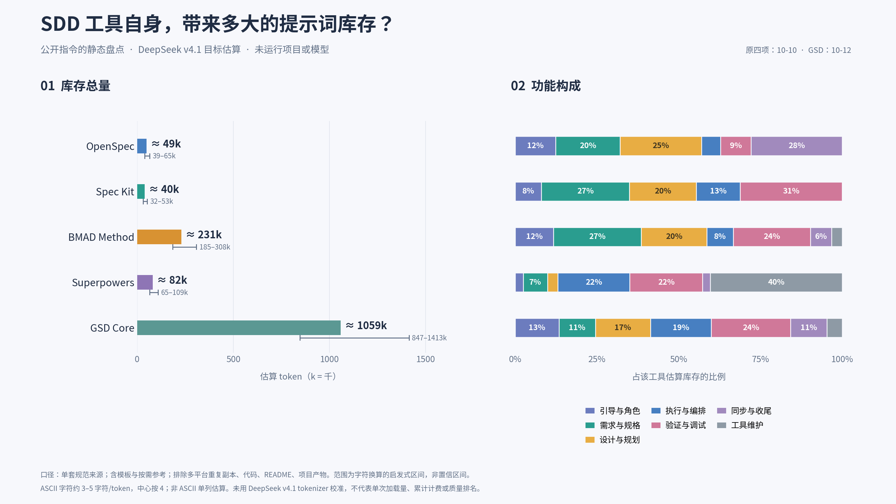
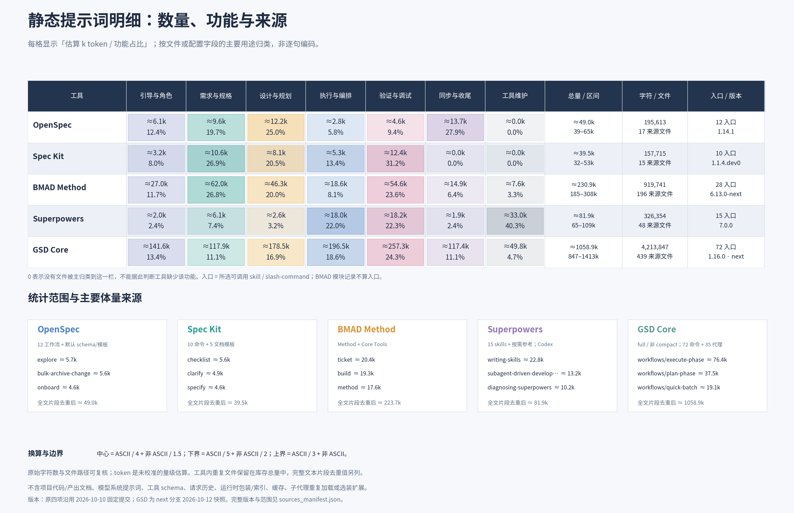

# SDD 工具静态提示词对比

## 个人演讲结论

以下是我个人的演讲结论：

1. **Superpowers**：从结构组成上看，更侧重工具和技能的维护，与其他 SDD 工具有明显不同。
2. **BMAD Method**：从提示词总量上看，体量过大，设计较为冗余。
3. **Spec Kit**：在验收方面的内容相对较少。
4. **OpenSpec**：最全面、最标准，可以作为比较基准。

对比 **OpenSpec、GitHub Spec Kit、BMAD Method、Superpowers、GSD Core** 自身的公开提示词体量及功能构成。

本轮只做静态盘点：不代入实际项目，不调用模型，不运行 tokenizer，不测算运行费用或结果收益。原四个工具沿用 **2026-10-10** 的固定提交；GSD Core 使用用户指定的 **`next` 分支，2026-10-12 快照**。以 DeepSeek v4.1 为目标，使用字符启发式估算 token 量级。

## 概览图：总量与功能占比



## 详细图：分类统计与来源范围



## 主要结果

| 工具 | 来源字符数 | 库存中心估算 | 启发式范围 |
|---|---:|---:|---:|
| OpenSpec | 195,613 | 约 49.0k token | 39–65k |
| Spec Kit | 157,715 | 约 39.5k token | 32–53k |
| BMAD Method | 919,741 | 约 230.9k token | 185–308k |
| Superpowers | 326,354 | 约 81.9k token | 65–109k |
| GSD Core | 4,213,847 | 约 1,058.9k token | 847–1,413k |

**这些数字表示所选完整可见指令库存，不代表每次任务的额外输入或累计计费。** 实际使用按需加载。估算未用 DeepSeek v4.1 tokenizer 校准；范围不是统计置信区间，也不保证覆盖真实 tokenizer 的结果。

- OpenSpec 主图包含全部 12 个工作流；默认 core 子集加 schema/模板约 27.5k。
- BMAD 范围为 Method + Core Tools，不包含独立 Toolsmith 扩展。
- Superpowers 约 40.3% 的库存属于技能编写和工具诊断；其余库存约 48.9k，仍不是一次任务的加载量。
- GSD Core 为 **full / 非 compact 规范源码库存**，包含 72 个命令、35 个代理指令、178 个工作流/片段、116 个参考材料、35 个模板和 3 个上下文指令，共 439 个来源文件。生成的 `skills/` 副本和 compact 替代版本不重复计入；不叠加选装能力、运行时转换包装和可执行代码。
- GSD 的约 **106 万 token** 是完整库存量级，包含其他路径和按需材料，不等于一次任务加载量。这里没有测量 minimal/core 安装配置或实际执行成本。
- 原四项使用默认分支固定提交，GSD 使用指定 next 分支；包含 Spec Kit dev 和 BMAD next，不声称所有样本均为稳定发布版。

## 查看与下载

- [完整统计报告与口径](output/README.md)
- [离线浏览页](output/comparison.html)：下载后用浏览器打开，支持按工具、功能、文件筛选与 CSV 导出。
- [完整成果包](output/SDD静态提示词对比.zip)：图片、PDF、SVG、数据、脚本和原始文本快照。
- 概览图：[PNG](output/01_overview_v4.png) · [SVG](output/01_overview_v4.svg) · [PDF](output/01_overview_v4.pdf)
- 详细图：[PNG](output/02_detail_v2.png) · [SVG](output/02_detail_v2.svg) · [PDF](output/02_detail_v2.pdf)
- [逐文件/配置字段明细](output/prompt_inventory.csv) · [工具汇总](output/tool_summary.csv) · [功能分类汇总](output/category_summary.csv)
- [固定版本来源](output/sources_manifest.json) · [完整数据与假设](output/comparison.json) · [排除文件清单](output/excluded_files.csv)
- GSD：[用户指定的中文 README](https://github.com/open-gsd/gsd-core/blob/next/README.zh-CN.md) · [固定快照 README](sources/gsd/README.zh-CN.md) · [范围、逐文件分类与 SHA256](sources/gsd/inventory_scope.json)

## 复核统计与重新出图

需要 Python 3.11+、依赖清单中的库，以及 Noto Sans CJK 字体。本轮渲染使用 Linux 字体路径 `/usr/share/fonts/opentype/noto/NotoSansCJK-Regular.ttc`；Ubuntu/Debian 可通过 `fonts-noto-cjk` 软件包提供。

在仓库根目录执行：

```bash
python -m venv .venv
source .venv/bin/activate
python -m pip install -r requirements.txt
python analyze.py
python render.py
```

`sources/` 保存本轮纳入的原始文本及统计所需模块清单，**不是工具的完整检出，也不用于安装或执行这些工具**。脚本从 `output/sources_manifest.json` 读取固定提交信息，不要求来源目录带有 Git 元数据。完整仓库的排除清单保留采集时的结果。

统计按文件或配置字段的主要功能归类，未逐句拆分。空白、标题、frontmatter 和示例保留；TOML/YAML 指令字段解析为原字符串。完整文本片段的重复量另列 SHA256 去重值，不做语义去重。

原始文本来源与许可证见 [THIRD_PARTY_NOTICES.md](THIRD_PARTY_NOTICES.md)。新版图表、CSV、网页和成果包覆盖原有文件路径；README 开头的个人演讲结论保留原文。
